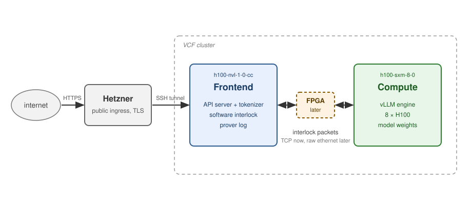
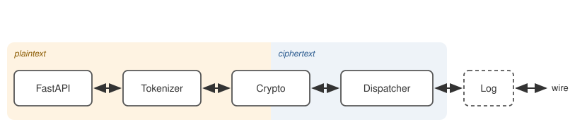
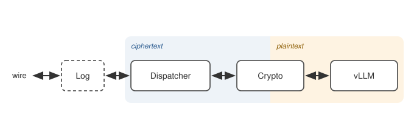

# VCF Software Stack Plan

Plan for standing up a realistic inference-serving stack on the VCF
(Verifiable Studio) cluster that speaks the interlock's packet protocol end
to end: first over an ordinary TCP tunnel, then over raw ethernet, and finally
through the FPGA once it is installed in the facility.

Companion to `verification-protocol.md`, the wire format the stack
implements. `prototype/` is the earlier software prototype, kept for
reference. Cluster findings are from 2026-10-27. The
paper calls the device the network certifier; this document says interlock
throughout.

## Summary

Requests arrive from the internet at a public Hetzner box, which terminates
TLS and forwards them through an SSH tunnel to the frontend node inside the
cluster. The frontend tokenizes and encrypts each request and sends it to the
compute node as packets in the interlock's format; the compute node runs the model and
returns the response the same way. A software interlock on the link certifies
the traffic until the FPGA is installed between the two nodes.

| Machine | Role | Standard software | Custom software |
|---|---|---|---|
| Hetzner box | public ingress | reverse proxy (Caddy or nginx) for TLS, sshd as tunnel endpoint | none, config only |
| `h100-nvl-1-0-cc` | prover frontend | FastAPI + uvicorn (HTTP), HuggingFace tokenizers (chat template, encode/decode), request encryption, response decryption | dispatcher, log |
| `h100-sxm-8-0` | prover compute | vLLM engine with tensor parallelism, model weights, request decryption, response encryption | dispatcher, log |

Note: the verifier role is also done by the Hetzner box.

## 1. The cluster

Two GPU nodes in separate racks, joined by a single 1 Gb/s link:

| | `h100-sxm-8-0` | `h100-nvl-1-0-cc` |
|---|---|---|
| Machine | bare metal, 8 GPUs | confidential VM, 1 GPU |
| Role in this plan | **compute node** | **frontend node** |

- Jobs are scheduled with Slurm from a login node. There is no sudo anywhere,
  and home directories are shared between the nodes.
- The two nodes sit on one flat Layer-2 segment: the inter-rack link is
  switched, not routed, so raw non-IP frames can cross it. TCP between the
  nodes runs at line rate.
- Raw sockets are denied to users on both nodes, and no unprivileged way
  around that exists (containers, file capabilities and user namespaces were
  all tried). See §6 for the admin-side fix that was requested.

## 2. Topology

**Node roles.** The frontend needs no GPU, and running the prover frontend
inside an attested confidential VM is a useful story later, so it goes on the
confidential VM. The 8-GPU node serves the model.

**The link.** Everything that crosses between the two nodes is a packet in
the interlock's format: a public header (ID, reference, key commitment) and
an encrypted payload of token ids. No text ever crosses. Until the FPGA is
installed, the packets travel over a TCP tunnel between the nodes; later the
same packets go out as raw ethernet frames (§6) and the FPGA takes over.

**Software interlock.** Until then, a relay on the TCP link stands in for the
device: it applies the validity rules, hashes the traffic and emits one
certificate per certificate interval, which gives the full certificate and
challenge flow before silicon. It emits the per-bucket sync feedback the
device sends, so bucket sync is built and tested against it, and its hashes
are what we diff against the FPGA. It runs on the frontend node for now.

**Verifier.** Runs on the Hetzner box, outside the cluster. It issues nonces
and challenges to the frontend over the tunnel, checks openings against
certificates, keeps the anchor log, and holds the HMAC key. The prototype's
verifier carries over.

**Ingress and TLS.** TLS is terminated at the first machine we control, the
Hetzner box, by a reverse proxy (Caddy) that holds the certificate and renews
it. The public name is the hostname Hetzner registers for the box's address;
Let's Encrypt issues for it like for any other name, so no domain had to be
registered or borrowed. The proxy forwards plain HTTP into an SSH reverse
tunnel that the frontend job opens outward, since the cluster exposes only
SSH. The tunnel logs in as a dedicated user on the box that may do nothing but
forward that one port. The tunnel is itself encrypted, so the request is
protected on every internet leg. The frontend process sees plain HTTP on its
loopback interface and can be exercised with `curl` on the node with nothing
in front of it.

TLS is the outer envelope and ends at the frontend. The interlock's payload
encryption is the inner envelope and begins there; the two never overlap. If
the admins later offer a proper ingress, only the tunnel changes.

## 3. The frontend

One process on the frontend node: a FastAPI server with OpenAI-style endpoints in
front of a fixed pipeline. It is the API gateway of a normal serving stack,
with tokenization and encryption moved into it. Requests flow left to right,
responses right to left through the same stages.

### Stages

| Stage | Standard or custom | Does |
|---|---|---|
| **FastAPI + uvicorn** | standard | OpenAI-style endpoints, body validation, API-key auth and a per-key concurrency cap through the framework's security dependency. |
| **Tokenizer** | standard (HuggingFace) | Chat template and encode on the way in, decode on the way out, `usage` counts. |
| **Crypto** | standard cipher | Encrypts each request under a fresh pair key, committed in the request's headers, and decrypts the response under the same key. Reassembles a response from its packets, since where a message ends is written inside the encrypted payload. Last stage that sees plaintext. |
| **Dispatcher** | custom | Payloads in, packets out. Stamps each packet of a chain with its ID, the bucket the interlock will be in when the packet arrives (tracked from the sync feedback) and the next slot, links it by reference and sends it in its bucket; on receive, hands packets over in order and reports the ones the sync reveals as dropped. Capacity is slots per bucket times bucket rate. Later holds the context index. Crypto above it never sees a packet; the wire below it never sees a message. |
| **Log** | custom | The exact bytes by ID, both directions, every certificate and the key material, kept for the challenge window. Audits each certificate against the log on arrival. |
| **Wire** | config | TCP tunnel now, tap device later (§6). Nothing above it knows which is in use. |

### Drops

The interlock drops invalid or late packets and forwards nothing about it.
The frontend learns of a drop from the sync feedback, which names the first
slot accepted in each bucket, or by timeout, and sends the request again as
a new chain under a new pair key.

### Not in the frontend

Skipped: load balancing, model routing, prompt caching, moderation,
multi-tenant quotas. Delegated outside the codebase: TLS termination and
public exposure (§2).

### Later

- **Context reuse.** The first version resends the full conversation every
  turn, which the engine's prefix cache handles well. Traffic over the
  interlock must be minimal, so the next step is that a follow-up turn sends
  only the appended tokens. The frontend keeps a context index: after each
  transaction it records, by content hash, the token context compute now holds
  (request plus response) under the ID of the transaction's last packet. A new
  request whose tokens begin with a recorded context is sent as the suffix
  only, referencing that ID; otherwise in full. If compute has evicted a
  referenced context it says so with a marker inside the encrypted payload and
  the frontend resends in full. The chat template must be prefix-stable
  across turns, one test per served model.
- **Streaming responses.** Compute can emit a response as several messages as
  tokens are produced, each a whole number of tokens chained by reference, and
  the frontend forwards each as a server-sent event.

## 4. The compute node

One process on the compute node: vLLM's engine in-process, with the same pipeline
in front of it as on the frontend. Requests arrive from the wire and flow left
to right, responses right to left through the same stages. The token ids that
come out of crypto are exactly what the tokenizer would have handed vLLM in a
normal stack; the interlock path is inserted into that line.

### Stages

| Stage | Standard or custom | Does |
|---|---|---|
| **vLLM** | standard | The engine, in-process: model loading, tensor parallelism across the GPUs, continuous batching across concurrent requests, KV cache and prefix caching. Takes token-id prompts and the generation parameters carried in the payload, returns token ids that go back down the same chain. No HTTP server and no tokenizer on this node. The call into it and the reply out of it are a few lines of plumbing, as on the frontend. |
| **Crypto** | standard cipher | Finds a request's pair key by the commitment in its header, reassembles and decrypts the request, and encrypts the response under the same key. |
| **Dispatcher** | custom | Stamps response packets with outbound IDs, in a bucket later than the request they reference, and sends them in their bucket, tracking the interlock's clock from the sync feedback on this port. |
| **Log** | custom | Exact bytes both directions. The protocol's prover log lives on the frontend; this copy is for debugging and for diffing hashes against the software interlock and the FPGA. |
| **Wire** | config | TCP tunnel now, tap device later (§6). |

### Models

vLLM with tensor parallelism across the 8 GPUs is the standard way to serve
open-weight models; the same code path serves a tiny model and a
frontier-class one. Bring-up and all testing use a small model (well under a
billion parameters). Any open-weight model whose weights fit in the node's GPU
memory is in reach afterwards. Weights are pulled once to the shared home
(check outbound internet from the nodes first, see §8).

### Drops

The interlock drops late or out-of-order response packets the same way as
requests; the sync feedback tells compute. The frontend, getting no answer,
re-issues the request under a new pair key and compute answers that one.

### Not on compute

No HTTP server, no tokenizer, no text, no API keys, no route to the internet.
The node sees only encrypted token messages and the engine.

### Later

- **Context store.** Keyed by the ID of the transaction's last packet: the
  token context compute holds after each transaction (request plus response).
  A follow-up turn arrives as a suffix referencing that ID; the engine runs on
  stored context plus suffix, where the prefix cache makes it cheap. The
  stored tokens are the authoritative state, the KV cache only an accelerator.
  A reference to an evicted context is answered with a marker inside the
  encrypted payload so the frontend resends in full.
- **Streaming.** Emit the response as several messages as tokens are
  produced, each a whole number of tokens, so the frontend can stream.

## 5. What exists already

`prototype/` is a working software version of the data path (chat CLI,
software interlock with HMAC certificates, verifier, HF-transformers Llama-2-7B
compute), verified end to end across the FPGA in June 2026. It is behind the
current spec: it speaks the older `ilock-v5` format without BUCKET, REFERENCE
or sync tracking, carries plaintext prompts, has no HTTP API, and moves
packets as JSON over TCP (the FPGA then ran a transparent passthrough
bitstream).

What carries over: the hashing, the prover log and the challenge openings, the
software interlock, and the verifier. New work: the packet format, the
dispatcher, the HTTP frontend, a real serving engine, and the raw-ethernet
wire.

## 6. Raw frames without root: tap device + tc redirect

The protocol needs plain 802.3 LENGTH frames on the wire, which normally
requires `CAP_NET_RAW`. That capability is kept from users because it allows
forging any frame, sniffing the whole segment, and bypassing the firewall. The
requested alternative is narrower and works unchanged inside the confidential
VM, where the hypervisor only tolerates the VM's own MAC:

1. **A tap device** owned by our user. A virtual interface whose "wire" is a
   file: frames written to the file go onto the tap, frames the kernel sends to
   the tap can be read from the file. No privileges needed after creation.
2. **An ingress classifier on the physical NIC.** Runs inline on each arriving
   frame, before the IP stack: if the length/type field holds a LENGTH value
   and the destination is this NIC's MAC, redirect it into the tap; otherwise
   fall through to normal processing. A few byte comparisons per frame, no
   batching, arrival order preserved.
3. **A classifier on the tap.** Frames written by us arrive on the tap from the
   kernel's point of view. If LENGTH frame with source = this NIC's MAC,
   redirect to the NIC's transmit queue; everything else is dropped, so the
   tap cannot be used to forge IP or ARP.

| Direction | Hook | Match | Action |
|---|---|---|---|
| wire → us | NIC ingress | LENGTH frame, dst = NIC MAC | redirect to tap |
| us → wire | tap ingress | LENGTH frame, src = NIC MAC | redirect to NIC tx |
| anything else from tap | tap ingress | no match | drop |

Frames carry the node's real MAC in both directions, so the hypervisor sees
nothing unusual, and ordinary IP traffic on the same NIC is untouched. A
macvtap would be simpler on bare metal but cannot share the parent's MAC and
so is unreliable behind a hypervisor. The admins were asked for this on
2026-10-27; a raw-frame ping probe is already staged on the cluster to run
once the tap exists.

Consequence for the real deployment: the FPGA currently forces the
destination MAC to a hardcoded constant. With a VM as compute node that
constant must become the VM's actual NIC MAC (a gateware constant, not a
protocol change), or the hypervisor must accept frames for the forced address.

## 7. Phases

| Phase | Deliverable | Wire | Estimate | Status |
|---|---|---|---|---|
| 0 | environment on the shared home, vLLM with a small model on the compute node, outbound internet confirmed, Hetzner proxy + reverse tunnel | — | ½ day | done 2026-10-27 |
| 1 | packet format and key handling with byte-exact tests against `verification-protocol.md` | — | 1 day | done 2026-10-28 |
| 2 | dispatcher and log; frontend and compute; chat end to end through the OpenAI API, then a large model | tcp | 2–3 days | done locally with a mock engine 2026-10-28; cluster run pending |
| 2b | context reuse: context index on the frontend, context store on compute, suffix-only turns | tcp | 1–2 days | — |
| 3 | software interlock on the link and the verifier on Hetzner; certificate audit and challenges; bucket sync against the software interlock's feedback | tcp | 1–2 days | done locally 2026-10-28, verifier CLI not yet on Hetzner; cluster run pending |
| 4 | tap device once the admins deliver; raw-frame ping, then the full stack | tap | 1 day | waiting for the admins |
| 5 | FPGA in the path: bucket sync against the device, pacing to the measured capacity, hash diff FPGA vs software interlock | tap + FPGA | when installed | — |

Each phase runs as a long-lived Slurm batch job per node, resubmitted when
the time limit hits, with the processes talking over the cluster network.
The code lives in `stack/` (see its README), the batch scripts in
`stack/deploy/`.
