# Inference Verification Prototype: Protocol, FPGA Network Certifier, and Zero Knowledge Proof

## TL;DR

We prototyped the verification protocol of the paper *[Verifying AI Compute by Bounding Unexplained Information Exfiltration](https://icml.cc/virtual/2026/78565)*: a way for a verifier to bound how much information leaves a prover's AI compute node that a declared inference workload cannot explain, without trusting the prover's hardware or software. A small trusted device, the *Network Certifier FPGA*, sits on the node's only network path, filters and then hashes all traffic, and regularly emits a signed certificate. The prover keeps the logs and, when challenged, opens the matching log slice against the certificate. A challenge-proof step then turns the opened response into a bound U on unexplained information, by isolated recomputation or by a zero-knowledge proof of the inference.

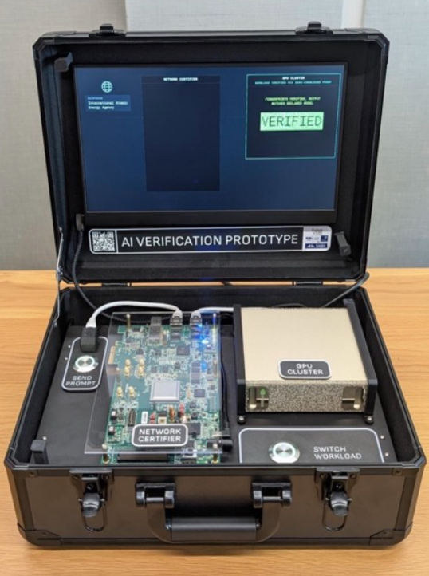

*Figure 1. The prototype certifier*

## 1. Background

The paper proposes a way for a compute operator (the *prover*) to show an outside party (the *verifier*) that an AI compute node is running only its declared inference workload, when neither side trusts the other's hardware or software. The node is isolated behind a device on its only network path, all traffic is hash-committed as it passes, and the verifier periodically challenges the prover to show that a randomly chosen output was well predicted by a compliant computation on the recorded inputs. The gap between the output and that prediction is the *unexplained information* U, an upper bound on what could have been smuggled out.

We developed a messaging protocol, the network certifier on an FPGA, the challenge flow around it, and two of the three recomputation options. This note describes what we built, how it maps onto the paper, and what we measured.

## 2. Overview of the proposal

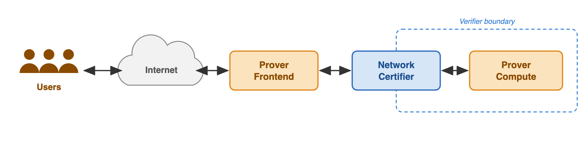
*Figure 2. The workload path*

Users send inference requests over the internet to the prover's **frontend**, which encrypts each request, wraps it in a small cleartext header, and keeps a log of everything it sends and receives. The request then crosses the **Network Certifier**, the verifier's device, on its way to the quarantined **compute node**, and the response comes back the same way. The certifier checks every packet against a few rules, hashes it, and emits it in bursts (buckets) to minimise timing side-channel bandwidth. Once per second it signs a certificate over everything that crossed. The **verifier** is remote: it holds the key the certifier signs with, sends nonces and challenges to the frontend, and never sees plaintext messages.

| Component | Role |
|---|---|
| Prover frontend | Terminates customer traffic, handles encryption and protocol format, keeps the logs |
| Prover compute | Handles encryption and protocol format, runs the inference |
| Network Certifier | Applies compliance checks to the packets, hashes the traffic, signs certificates |

The protocol runs in two phases. In the **workload phase** traffic flows as usual and the certificates are injected into the traffic to be sent to the verifier. In the **challenge phase**, the verifier picks a random position in the output traffic, and asks the prover to verifiably demonstrate the entropy of the data in that position. With enough samples, the verifier can be highly confident that the amount of covert information potentially encoded in the traffic not more than an estimated value.

## 3. Traffic on the wire

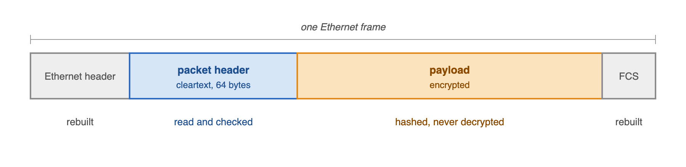
*Figure 3. Packets on the wire*

The certifier understands exactly one kind of traffic: plain Ethernet frames, each carrying one protocol packet, a cleartext header followed by an encrypted payload. Anything else is dropped. The header is the only part the certifier reads; the payload it only hashes.

### 3.1 Ethernet frames

Ethernet is used only so that ordinary network interfaces can be used on both sides of the network certifier; the protocol itself does not rely on it.

An Ethernet frame carries more than its payload: the header and checksum fields could be used to smuggle data, so the certifier does not forward these at all. It builds a fresh frame from scratch on the other side.

### 3.2 Custom packet format

We use custom packets with two parts: header and payload.

The header is what the certifier checks. It contains the metadata of the packet such as a unique ID, length and timing information. The header must pass several protocol compliance checks or it is simply dropped by the certifier.

A message is encrypted and split across as many packets as needed. Each packet references the previous one, so the packets of a message form a linked list. We recommend self-delimiting messages, so that the receiver can tell where a message ends instead of relying on packet boundaries.

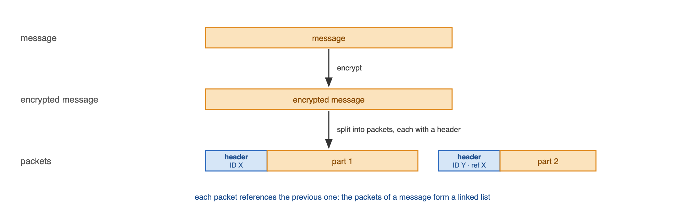
*Figure 4. Packet construction*

### 3.3 Timing buckets

When a packet is sent is information too. Even with every byte of payload accounted for, a sender could signal through the exact moment it transmits. The certifier minimizes this channel by making time coarse and explicit.

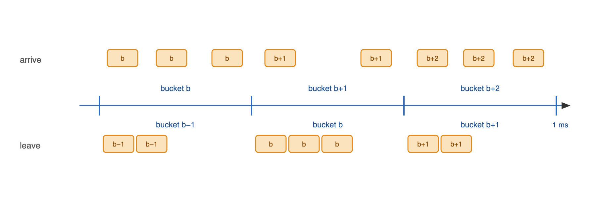
*Figure 5. Timing buckets*

The certifier's clock divides time into 1 ms buckets. Every packet header carries the number of the bucket it is being sent in, and the certifier accepts a packet only if it arrives during that bucket; a packet stamped with any other bucket is dropped. Accepted packets are held and released together at the end of the bucket. From outside, all that can be seen is which bucket a packet belonged to, and that is written in the packet itself, so it is hashed and certified with the rest.

To hit the right bucket, the sender has to be in sync with the certifier's clock. Once per millisecond the certifier sends a short sync packet back to the sender on each side, carrying the number of the bucket that just closed and how far into it that side's first packet arrived; the sender uses this to keep its independent clock in sync (§3.5).

### 3.4 Bucket slots

To further quantize the channel, we split each bucket into a fixed number of slots. Each slot either carries a single bucket or stays empty. The compute node can vary only what it puts into each slot on the response side, and every slot is measured.

*Figure 6. Bucket slots*

### 3.5 Control packets

The wire also carries three control packets using ID values reserved for this purpose. None of these cross the isolation boundary and hence are kept out of the traffic hashes.

| Packet | Id | Direction | Description |
|---|---|---|---|
| Nonce | 0 | frontend → certifier | Loads a new nonce into the certifier to indicate freshness |
| Certificate | 0 | certifier → frontend | Carries the certificate (§5) |
| Sync | 1 | certifier → each sender | Timing feedback to keep the senders' independent bucket clocks in sync |

## 4. The Network Certifier FPGA

A passive tap could record the traffic, but an active inline device can also filter some of the noise on the channel like timing variance and can enforce the wire protocol that simplifies estimating unexplained information.

The certifier is similar to an in-line network encryptor device - some of which are military grade tamper and security hardened - such as a [TACLANE](https://gdmissionsystems.com/encryption/taclane-network-encryption), but it hashes the traffic instead of encrypting it. (Note that the inference request and response messages might also be encrypted when passing through the certifier.)

Our prototype uses a Microchip PolarFire MPF300TS FPGA on Microchip's evaluation kit, with two gigabit Ethernet ports. There is no CPU in the data path, everything beyond the Ethernet PHYs is logic in the FPGA fabric.

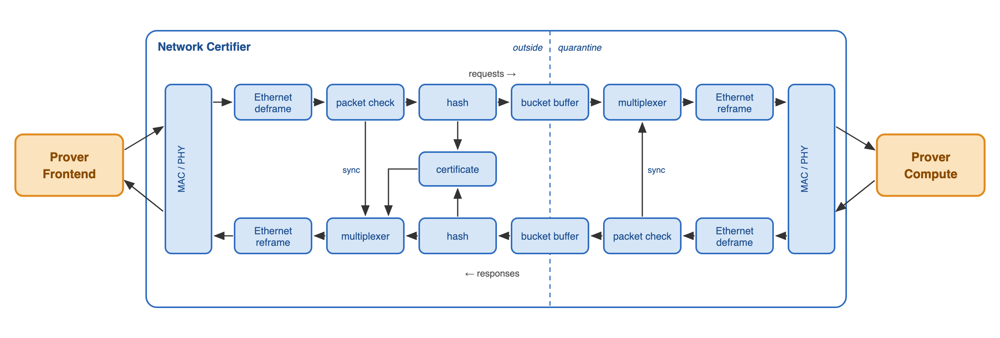
*Figure 7. Network Certifier FPGA data path*

| Stage | Description |
|---|---|
| Ethernet deframe / reframe | Takes the payload out of each Ethernet frame and builds a fresh one on the way out (§3.1) |
| packet check | Checks the header (§3.2) including the timing bucket (§3.3), and also sends the sync packets (§3.5) |
| hash | Folds each accepted packet into the running hashes (§5) |
| bucket buffer | Holds the packets of the current bucket and releases them together at the next bucket tick |
| multiplexer | Merges multiple packet sources heading the same way |
| certificate | Signs the two directions' hashes (§5) and the latest nonce and sends the certificate (§3.5) |

Each direction has its own pipeline. Hashing happens on the outside for both so the digests don't need to cross the boundary. Sync packets go back to the side they measure, so they never cross the boundary.

## 5. Certificates

Once per second the certifier sends the frontend a **certificate**. It carries one hash of the request traffic and one of the response traffic, a verifier nonce to indicate freshness and is cryptographically signed by a secret key.

The two traffic hashes are built in layers (Figure 8): each packet becomes a record; the records of a bucket are hashed together; and buckets within a second are also hashed together. The layers exist so that a challenge can open a single packet with minimal data sent to the verifier.

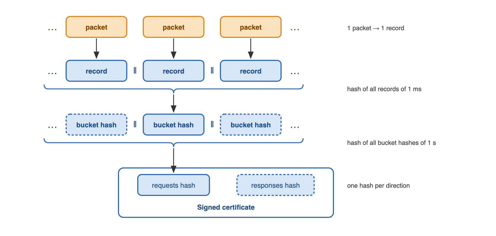
*Figure 8. How traffic hashes are built*

## 6. Inference verification protocol

In general, any response could depend on every message (in both directions) that came before it. Inference is simpler: thousands of sessions run side by side, and each response depends on a small fraction of the earlier packets. We specialise the protocol to that case for estimating unexplained information.

We also introduce response schedule prediction to simplify the estimation of unexplained information.

### 6.1 Context chains

The references turn each session into a chain (§3.2). When a response is challenged, following its chain back collects exactly the inputs - the context - its predictor may use, instead of every packet that passed the certifier. Figure 9 shows a short conversation as packets.

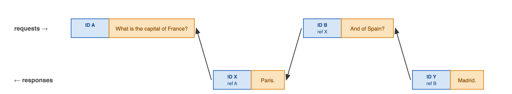
*Figure 9. A conversation as packets*

### 6.2 Response schedules

Response packets are produced by the compute node, so everything about them has to be paid for: not just the payload, but also which previous packet it references. Charged at face value, the reference field alone would cost tens of bits per response. Schedule packets remove most of that cost.

The frontend sends a plaintext schedule packet (Figure 10) in the request direction for each response bucket. It assigns the response slots to particular references, each with a probability P that the response will be ready in time. The compute node fills a scheduled slot with the response if it is ready and leaves it empty otherwise; the frontend reschedules responses that were not ready.

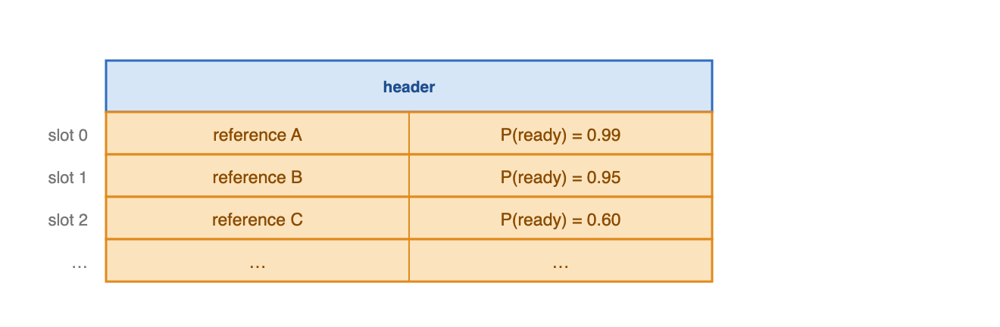
*Figure 10. A schedule packet*

The frontend trades latency for unexplained information. Scheduling once a response is almost certainly ready (e.g. P=0.99) keeps the average cost low; scheduling early (e.g. P=0.5) cost more per slot but keeps latency low even when timing is hard to predict.

## 7. Challenges

### 7.1 Anchoring

To verify the traffic of a previous interval (e.g. the last day or week), the verifier must first ensure that it is looking at the latest certificates. It sends a random nonce, which the interlock certifies. A certificate carrying a hash of the nonce was therefore built after the nonce was sent. The certificates are also constructed in a way such that the verifier can check if a certificate indeed belongs to a given previous position in the certificate stream.

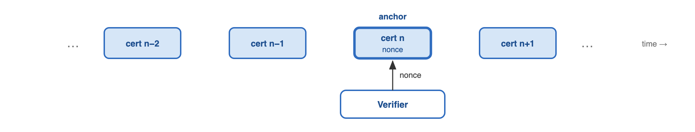
*Figure 11. Anchoring to a fresh certificate*

### 7.2 Sampling

After anchoring to a recent certificate, the verifier randomly picks from the response slots of all buckets in the verified interval.

To reduce the number of samples required, the verifier could do a larger sample first and request the prover to calculate and commit the amount of unexplained information for those. Then randomly select from the samples and run the full challenge on them to see if the prover reported honestly.

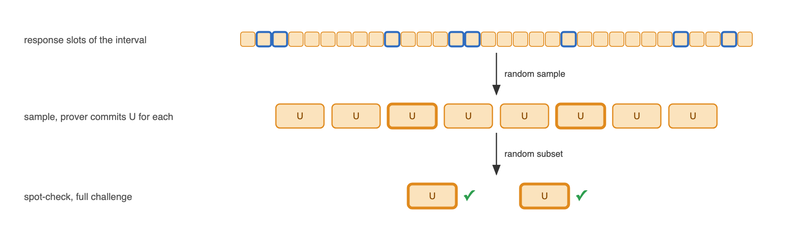
*Figure 12. Two-stage sampling*

### 7.3 Opening the packet at a challenged slot

If a challenged slot is not empty, the prover must open the commitment of the packet to reveal the references and also attach the neighboring commitments to reconstruct the certificate hash. The same step must then be repeated along the whole reference chain to collect the full context.

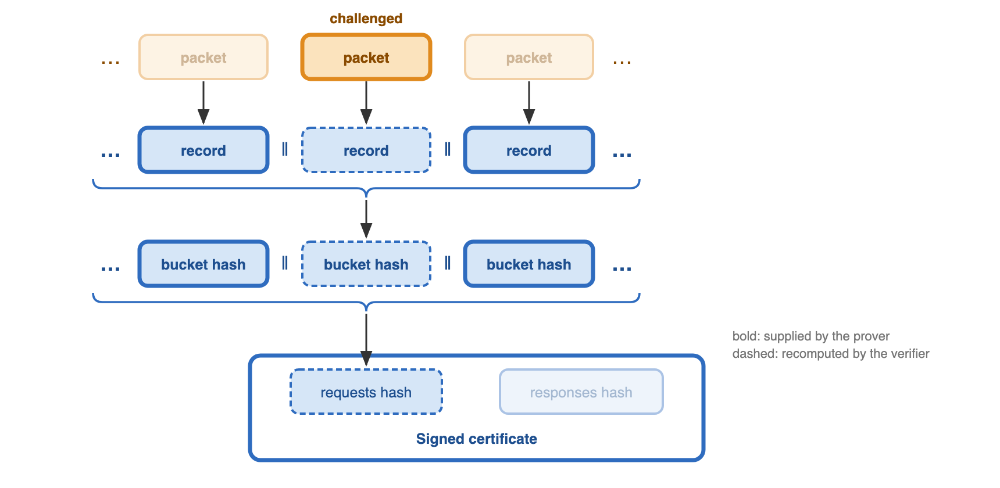
*Figure 13. Opening a packet*

The prover must also open the schedule packet of the slot.

If a reference or schedule packet is missing or does not match the corresponding certificate, worst case charges are applied, so withholding or fabricating never reduces the charge.

### 7.4 What a challenged slot pays

A challenged response slot is charged for its reference (based on the schedule packet) and its payload (based on ZKP). The reference is public, so the verifier evaluates the prediction itself; only the payload needs the Zero Knowledge Proof. An empty slot also pays based on the schedule and is answered with the network certificate alone.

| Charge for | Predicted from | The prover supplies |
|---|---|---|
| Reference/Empty slot | The schedule packet | The opened schedule packet |
| Payload | The declared model, given the context | The opened headers + ZKP |

If a certificate is missing, worst case charges are applied, so withholding certificates never reduces the charge.
